<div align="center">


<br/>

**Building AI-powered products that adapt to the people who use them.**

<br/>

<a href="https://github.com/Dishari-Ghosh"></a>
<a href="https://www.linkedin.com/in/dishari-ghosh-087110286/"></a>
<a href="https://www.kaggle.com/disharighosh7"></a>
<a href="mailto:disharighosh77@gmail.com"></a>

</div>

<br/>

<div align="center"></div>

<br/>

Hi, I'm **Dishari Ghosh**, a final-year student at Narula Institute of Technology who likes understanding how things work and then building them.

I'm drawn to AI, machine learning and data science, and I build full web projects end to end: my own dataset, a React frontend, a FastAPI backend and a machine-learning layer.

**My principle:** Understand deeply. Build intelligently.

```yaml
name: Dishari Ghosh
status: 4th-year student
institute: Narula Institute of Technology
flagship: VOYEXA AI
interests: [AI / ML, Data Science, Software Development]
currently: Learning Docker, exploring ML
```

<details>
<summary><b>⌘ VIEW WHOAMI — JAVA SOURCE CODE</b></summary>

```java
public class DishariGhosh {

    String name = "Dishari Ghosh";
    String role = "Developer & Tech Enthusiast";

    String[] languages = {
        "Java", "Python", "C", "C++"
    };

    String[] interests = {
        "Data Science",
        "Machine Learning",
        "Artificial Intelligence",
        "Software Development"
    };

    void philosophy() {
        System.out.println(
            "Understand deeply. Build intelligently."
        );
    }

    public static void main(String[] args) {
        DishariGhosh developer = new DishariGhosh();
        developer.philosophy();
    }
}
```

</details>

<br/>

<div align="center"></div>

<br/>

<div align="center">


<br/>

<a href="https://voyexa-ai.vercel.app/"></a>
<a href="https://github.com/Dishari-Ghosh/Voyexa-AI"></a>
<a href="https://voyexa-ai.onrender.com/"></a>

</div>

<br/>

**VOYEXA AI is a travel-planning website for exploring India, and it treats every trip as different.** Most travel sites show the same fixed places and budgets to everyone. VOYEXA plans around who is actually travelling, how long they have, and what they can spend.

<div align="center">

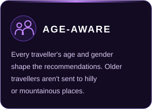
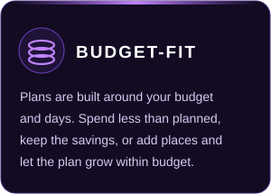
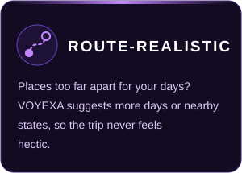

</div>

<!--
  SCREENSHOTS (optional, add later):
  1. In your profile repository, create a folder called assets/screenshots and upload your images there.
  2. Delete the first and last line of this block (the comment markers) and fix the file names below.

<div align="center">


</div>
-->

### How it works

1. **Create one account for the whole trip.** Choose solo, couple, family or friends, then enter every traveller's age and gender.
2. **Set your budget and days.** For example, ₹1,00,000 for 5 days.
3. **Pick a state, then pick places** from a dropdown of destinations in that state.
4. **Get a realistic plan.** If the places are too far apart for your days (say, Jammu & Kashmir and Kerala in 5 days), VOYEXA suggests adding days or choosing nearby states so the schedule isn't hectic.
5. **Stay within budget.** The plan is fitted to your budget. If a ₹1,00,000 trip can be done for ₹80,000, you keep the difference, and you can add places or days later as long as the plan stays inside your budget.

<div align="center">


<sub>Frontend on Vercel · Backend on Render · Repository layout: <code>frontend/</code> · <code>backend/</code> · <code>ml/</code> · <code>data/</code></sub>

</div>

<br/>

<div align="center"></div>

<br/>

<div align="center">

`// LANGUAGES`


<br/><br/>

`// WEB & BACKEND`


<br/><br/>

`// DATA SCIENCE, ML & COMPUTER VISION`


<sub>Also: Seaborn</sub>

<br/><br/>

`// CURRENTLY LEARNING`


</div>

<br/>

<div align="center"></div>

<br/>

<div align="center">


</div>

<br/>

<div align="center"></div>

<br/>

<div align="center">


<br/><br/>


</div>

<br/>

<div align="center"></div>

<br/>

<div align="center">

Open to conversations about AI, data and software projects.

<br/>

<a href="https://www.linkedin.com/in/dishari-ghosh-087110286/"></a>
<a href="mailto:disharighosh77@gmail.com"></a>
<a href="https://www.kaggle.com/disharighosh7"></a>

</div>

<br/>

<div align="center">


</div>
